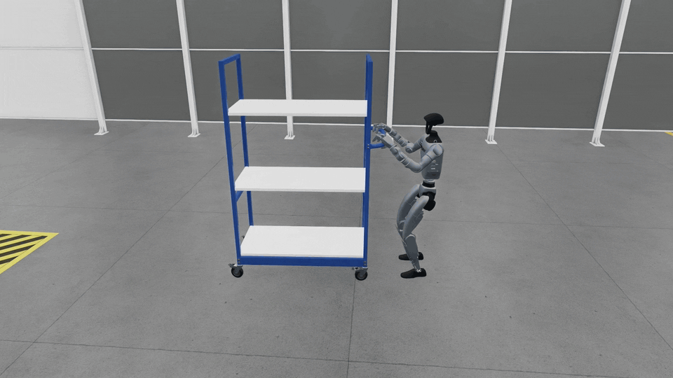

<div align="center">

# G1 Factory

### Whole-Body Humanoid Locomanipulation Benchmark for Industrial Tasks

[](https://docs.isaacsim.omniverse.nvidia.com/latest/)
[](https://github.com/isaac-sim/IsaacLab)
[](https://github.com/isaac-sim/IsaacLab-Arena)
[](https://github.com/NVIDIA/Isaac-GR00T)
[](https://www.python.org/)
[](LICENSE.md)



</div>

---

## Overview

**G1 Factory** is a whole-body humanoid locomanipulation benchmark for industrial
tasks built on [Isaac Lab-Arena](https://github.com/isaac-sim/IsaacLab-Arena).
It supports human demonstration collection,
[GR00T N1.7](https://github.com/NVIDIA/Isaac-GR00T) fine-tuning, and standardized
closed-loop policy evaluation.

**The benchmark includes:**

- **Benchmark tasks** — Nine industrial locomanipulation tasks.
- **Demonstration datasets** — 100 demonstrations per task.
- **Closed-loop evaluation** — Standardized policy evaluation through Isaac Lab-Arena.

**The benchmark workflow has three stages:**

1. **Collect demonstrations** — Capture human demonstrations through teleoperation.
2. **Train policies** — Fine-tune GR00T N1.7 on individual tasks or jointly across the full benchmark.
3. **Evaluate policies** — Measure closed-loop success rates across all nine benchmark tasks.

See [Available G1 Factory Environments](#available-g1-factory-environments) for
the supported tasks.

## Setup

### Clone the repository

Clone G1 Factory and initialize its required submodules:

```bash
git clone https://github.com/NVlabs/G1-Factory.git
cd G1-Factory
git -c url."https://github.com/".insteadOf=git@github.com: submodule update --init \
  submodules/IsaacLab-Arena submodules/Isaac-GR00T
git -C submodules/IsaacLab-Arena -c url."https://github.com/".insteadOf=git@github.com: \
  submodule update --init submodules/IsaacLab
```

### Set up G1 Factory

Install and activate the G1 Factory environment from the repository root:

```bash
uv sync
source .venv/bin/activate
```

### Set up NVIDIA Isaac GR00T

Set up Isaac GR00T for fine-tuning and inference:

```bash
uv sync --project submodules/Isaac-GR00T
```

### Select a task

```bash
export ARENA_REPO_DIR="$(pwd)"
export TASK="<environment-name>"
export LEROBOT_CONFIG="${ARENA_REPO_DIR}/g1_factory/configs/gr00t/lerobot/${TASK}_locomanip_config.yaml"
export POLICY_CONFIG="${ARENA_REPO_DIR}/g1_factory/configs/gr00t/policy/${TASK}_closedloop_config.yaml"
export DATASET_DIR="${ARENA_REPO_DIR}/datasets/g1_factory"
```

---

## 1. Teleoperation

Open two terminals at the repository root and activate `.venv` in both.
Set the task variables above in the terminal used for recording.

Start the CloudXR runtime in the first terminal:

```bash
python -m isaacteleop.cloudxr
```

Load the generated CloudXR settings in the second terminal before starting the
recorder:

```bash
source ~/.cloudxr/run/cloudxr.env
```

After launching the recorder below, start the session from the **XR** tab in the
Isaac Sim application window and connect the headset. Follow the
[Arena teleoperation guide](https://isaac-sim.github.io/IsaacLab-Arena/main/pages/example_workflows/locomanipulation/step_2_teleoperation.html)
for complete CloudXR and Meta Quest setup instructions. See the
[Isaac Lab CloudXR guide](https://isaac-sim.github.io/IsaacLab/main/source/how-to/cloudxr_teleoperation.html)
for additional details.

---

## 2. Record Demonstrations

Record camera-enabled teleoperated demonstrations directly to an HDF5 file:

```bash
mkdir -p "$DATASET_DIR"
python submodules/IsaacLab-Arena/submodules/IsaacLab/scripts/tools/record_demos.py \
  --viz kit \
  --device cpu \
  --xr \
  --enable_cameras \
  --kit_args "--/app/asyncRendering=false --/app/asyncRenderingLowLatency=false" \
  --no-auto_launch_cloudxr \
  --dataset_file "$DATASET_DIR/${TASK}.hdf5" \
  --num_demos 100 \
  --num_success_steps 10 \
  --external_callback isaaclab_arena.environments.isaaclab_interop.environment_registration_callback \
  --external_environment_class_path "g1_factory.environments.${TASK}:${TASK}" \
  --task "$TASK" \
  --arena_teleop_device openxr
```

---

## 3. Replay Demonstrations (Optional)

Use Isaac Lab's replay tool to inspect a recorded dataset:

```bash
python submodules/IsaacLab-Arena/submodules/IsaacLab/scripts/tools/replay_demos.py \
  --viz kit \
  --device cpu \
  --dataset_file "$DATASET_DIR/${TASK}.hdf5" \
  --external_callback isaaclab_arena.environments.isaaclab_interop.environment_registration_callback \
  --external_environment_class_path "g1_factory.environments.${TASK}:${TASK}" \
  --task "$TASK"
```

---

## 4. Convert to LeRobot Format

Convert the recorded HDF5 dataset directly to LeRobot format for GR00T fine-tuning:

```bash
python submodules/IsaacLab-Arena/isaaclab_arena_gr00t/lerobot/convert_hdf5_to_lerobot.py \
  --yaml_file "$LEROBOT_CONFIG"
```

The conversion config specifies the data root, HDF5 filename, field mappings,
language instruction, and image sizes. Update it for the selected task and dataset.

### Download demonstrations

The [G1 Factory Benchmark dataset](https://huggingface.co/datasets/masoudmoghani/G1-Factory-Benchmark)
provides 100 demonstrations per task in LeRobot format. Download it to `datasets/`:

```bash
git clone https://huggingface.co/datasets/masoudmoghani/G1-Factory-Benchmark datasets/G1-Factory-Benchmark
```

---

## 5. Fine-Tuning (GR00T N1.7)

Fine-tune GR00T N1.7 on the selected dataset:

```bash
cd "${ARENA_REPO_DIR}/submodules/Isaac-GR00T"
CUDA_VISIBLE_DEVICES=0 uv run python gr00t/experiment/launch_finetune.py \
  --base-model-path nvidia/GR00T-N1.7-3B \
  --dataset-path /path/to/task/lerobot \
  --output-dir /path/to/output \
  --modality-config-path "${ARENA_REPO_DIR}/submodules/IsaacLab-Arena/isaaclab_arena_gr00t/embodiments/g1/g1_sim_wbc_data_gr00t_n_1_7_config.py" \
  --embodiment-tag NEW_EMBODIMENT \
  --global-batch-size 12 \
  --max-steps 20000 \
  --num-gpus 1 \
  --tune-visual --tune-projector --tune-diffusion-model --no-tune-llm
```

For multitask training, pass dataset paths separated by `:` to `--dataset-path`.

---

## 6. Evaluation (Closed-Loop)

Evaluation requires two terminals: one Isaac GR00T N1.7 server and one Isaac Lab-Arena simulation client.

### Terminal 1: Isaac GR00T N1.7 Server

From the repository root, start the GR00T policy server:

```bash
cd submodules/Isaac-GR00T
uv run python gr00t/eval/run_gr00t_server.py \
  --model-path /path/to/model \
  --embodiment-tag NEW_EMBODIMENT \
  --device cuda \
  --host 0.0.0.0 \
  --port 5555
```

### Terminal 2: Isaac Lab-Arena Simulation Client

From the repository root, activate `.venv` and set the variables in
[Select a task](#select-a-task).

```bash
python submodules/IsaacLab-Arena/isaaclab_arena/evaluation/policy_runner.py \
  --policy_type isaaclab_arena_gr00t.policy.gr00t_remote_closedloop_policy.Gr00tRemoteClosedloopPolicy \
  --policy_config_yaml_path "$POLICY_CONFIG" \
  --viz kit \
  --device cpu \
  --seed 42 \
  --remote_host 127.0.0.1 \
  --remote_port 5555 \
  --num_episodes 100 \
  --enable_cameras \
  --external_environment_class_path "g1_factory.environments.${TASK}:${TASK}" \
  "$TASK" \
  --embodiment g1_factory_wbc_joint
```

---

## Available G1 Factory Environments

| Environment | Description |
|---|---|
| `LMBoxLift` | Walk to the table and pick up the box |
| `LMBoxLiftFloor` | Walk to the box and pick it up from the floor |
| `LMBoxTableToShelfPnP` | Move the box from the table to the shelf |
| `LMDrillLift` | Walk to the table and pick up the power drill |
| `LMDrillLiftObs` | Navigate around the shelf and pick up the power drill from the table |
| `LMDrillPnP` | Move the power drill from one table to another |
| `LMPickDrillFromHolder` | Pick up the power drill from the holder |
| `LMPushButton` | Walk to the console and press the red button |
| `LMPushShelfForward` | Push the tall wheeled shelf to the marked area |

## Citation

If you use G1 Factory in your research, please cite:

```bibtex
@misc{g1factory2026,
    title  = {G1 Factory: Whole-Body Humanoid Locomanipulation Benchmark for Industrial Tasks},
    author = {{NVIDIA}},
    year   = {2026},
    url    = {https://github.com/NVlabs/G1-Factory}
}
```

## License

G1 Factory is licensed under the [Apache License 2.0](LICENSE.md).
Third-party components retain their own licenses as described in
[THIRD_PARTY_NOTICES.md](THIRD_PARTY_NOTICES.md).
